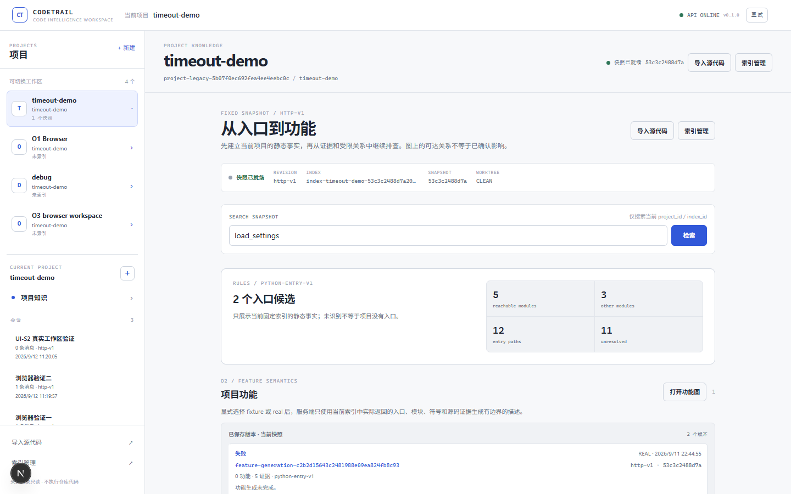
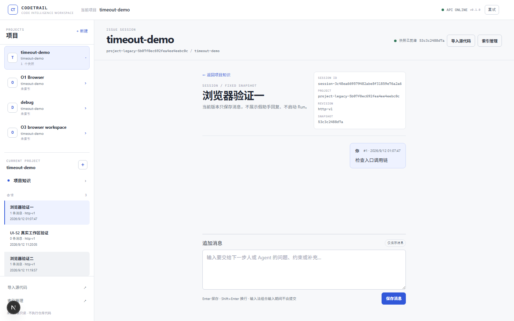
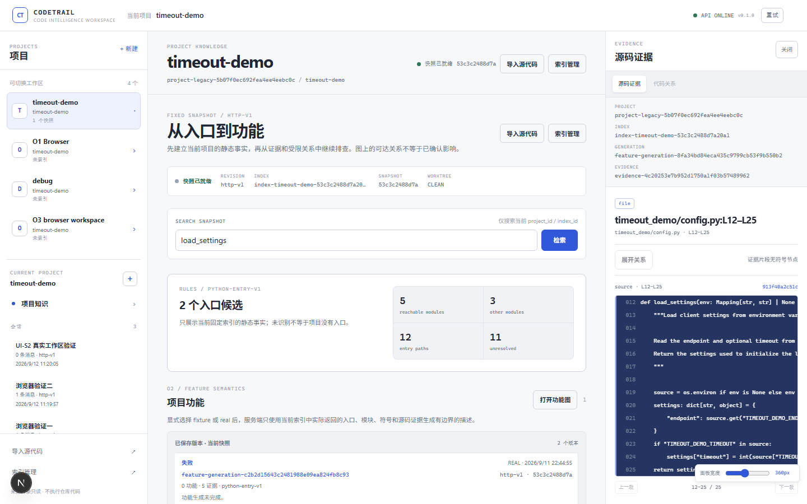

# CodeTrail

理解项目结构、追踪代码关系，并用源码证据调查 Issue。CodeTrail 为项目和 Session 提供共享索引、架构知识页及可展开的代码视图；调查结果会关联固定索引、源码证据和影响范围。

[](https://github.com/MAGMA27/CodeTrail/actions/workflows/ci.yml) [](https://github.com/MAGMA27/CodeTrail/actions/workflows/docs.yml)

## 快速开始

安装 Docker 和 Docker Compose 后，在仓库根目录运行：

```sh
docker compose up --build
```

打开 [http://localhost:3000](http://localhost:3000)。API 位于 `http://localhost:8000`。停止服务可按 `Ctrl+C`。

Compose 默认网络为 `192.168.253.0/24`；启动前用 `ip route` 检查是否与现有路由重叠，如需更换，可在仓库根目录 `.env` 设置 `CODETRAIL_COMPOSE_SUBNET`。

## 产品界面



项目知识页展示固定快照状态、快照搜索、入口候选统计和项目功能。



Session 页面展示会话消息和输入框。



证据面板展示文件位置、行号范围和对应源码。

## 能做什么

- 为 Python、TypeScript 和 TSX 项目建立索引，浏览项目结构、符号及保守静态代码关系。
- 在知识页查看职责和模块，按需展开代码并查看源码行号证据。
- 保存项目 Session 与消息，通过 Codex MCP 发起 Issue 调查，查看执行过程、调查报告和证据。
- 浏览报告候选关联的静态影响范围；静态可达不等于已确认影响，报告也不代替运行时复现。

浏览层级：**项目 → 职责/目录 → 模块 → 符号 → 源码**。

动态调用或无法解析的关系会保留为未知。CodeGraph 和 Archify 是设计参考，当前不是 CodeTrail 的集成依赖。

## 运行模式

Web 通过 HTTP 使用 FastAPI API；MCP server 是独立的 stdio 入口，并复用相同的应用服务。

轻量模式不设置 `CODETRAIL_REDIS_URL`：API 使用 SQLite 保存任务状态，并由进程内线程执行后台任务；周期扫描器会重新调度排队任务，并处理租约过期的运行任务。进程退出期间没有 worker 执行任务，进程崩溃后的恢复不作保证。

完整模式通过 `CODETRAIL_REDIS_URL` 连接 Redis，由 arq 队列分发任务。在 Compose 外，在 API 和 worker 环境中设置该变量，并运行 `codetrail worker`；仓库根目录的 Docker Compose 会启动 Redis、API、worker 和 Web。任务状态及项目数据保存在共享 SQLite 数据卷，Redis 队列使用启用 AOF 的持久卷；PostgreSQL 尚未接入。

HTTP Real Run 默认关闭：在 `~/.config/codetrail/settings.json` 设置 `"real_run_enabled": true` 可启用；Compose 可在根目录 `.env` 设置 `CODETRAIL_REAL_RUN_ENABLED=1`。启用后，已保存的 Session 消息和有界源码证据会发送给配置的模型供应商，可能产生费用。

## Windows 手动启动

需要 Node.js、pnpm、uv 和 Python 3.10–3.13。在仓库根目录的 PowerShell 终端中运行：

```powershell
pnpm install --frozen-lockfile
uv tool install ./apps/api
codetrail init
codetrail api
```

另开一个终端启动网页：

```powershell
pnpm web:dev
```

打开 [http://localhost:3000](http://localhost:3000)。若找不到 `codetrail` 命令，运行 `uv tool update-shell` 后重新打开终端。

## 调查流程

导入本地项目或公开 GitHub 仓库，等待索引完成后打开项目知识页。连接 Codex MCP（需要 Codex CLI）：

```powershell
codetrail install
```

首次初始化仅允许导入当前目录；要导入其他本地目录，按[本地路径配置](apps/api/mcp.md)添加允许路径。在工作台创建 Session 并保存 Issue，然后在 Codex 中发出调查请求，例如：

> 使用 CodeTrail MCP 调查“我的项目”中刚保存 Issue 的 Session。核对项目和固定索引，创建调查 Run，给出问题位置、源码证据和影响范围；证据不足时明确说明。

调查不会因保存消息自动启动。CodeTrail MCP 复用工作区中的项目和固定索引，结果可在 Session 页面查看；此流程不需要额外配置模型供应商密钥。

源码变化后，在索引管理中检查并显式更新索引；旧 Session 和报告仍关联原代码快照。项目、消息和报告会持久化，切换或刷新后可继续查看。

## 文档与开发

- [CLI、共享配置与 MCP](apps/api/mcp.md)
- [Run 执行与限制](apps/api/execution.md)
- [工作台说明](apps/web/workbench.md) · [API 说明](apps/api/README.md)
- [产品目标规范](docs/design/product-understanding-spec.md) · [开发者操作流程](docs/mvp-operation.md) · [MVP 验收清单](docs/mvp-acceptance.md)
- [样本与离线演示](fixtures/README.md) · [评测](evals/README.md) · [设计决策](docs/decisions/README.md)
- [开发规范](AGENTS.md) · [子系统索引](docs/subsystems/README.md)

源码更新后，重装本地 API/MCP：`uv tool install --force ./apps/api`。
