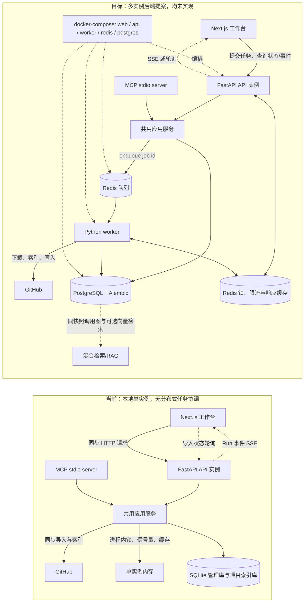

# 决策：后端基础设施分阶段演进提案

Status: proposed

## 问题

当前 API 实例在 HTTP 请求期间同步完成 GitHub 获取、解包和索引；索引并发、导入互斥及若干缓存位于进程内，持久化主要由 SQLite 承担。该模式适合本地单实例运行，但不能安全地通过增加 API/worker 实例扩展索引吞吐，也无法让多个实例共享 GitHub 限流状态和响应缓存。索引耗时还直接占用浏览器请求连接。

此提案规划从当前实现演进到 Redis 任务队列、Redis 分布式协调与 PostgreSQL 的传统后端部署。本文所有目标架构、依赖选择和阶段均为提议，尚未实现。当前事实以 [API 说明](../../apps/api/README.md)、[API 专题](../../apps/api/api.md)、[存储说明](../../apps/api/storage.md) 和 [工作台说明](../../apps/web/workbench.md) 为准。

### 当前架构（代码核实）

- Web 工作台由 Next.js 提供，通过 HTTP 访问 FastAPI API；MCP server 是独立 stdio 适配入口，与 HTTP 复用应用服务。MCP 客户端、Web 和 API 不应被描述成同一个操作系统进程。
- `apps/api/pyproject.toml` 的运行时依赖只有 `fastapi`、`mcp`、`pydantic`、`uvicorn[standard]`；`pytest` 位于开发依赖组。没有 Redis、PostgreSQL、任务队列或 ORM 运行依赖。
- SQLite 由 `apps/api/app/storage.py` 中的 `ManagementStore`、`IndexStore` 等直接管理，项目来源、导入 attempt、索引快照、Session、Run、证据和派生缓存等分布在管理库及项目索引库中。`apps/api/app` 下约有 148 行源码包含大小写不敏感的 `sqlite`/`sqlite3` 字样（按检索命中行计数，不代表 SQL 语句、表或调用点数量）；相关引用集中在 `storage.py` 与 `service.py`。静态仓库兼容路径还会使用来源目录下 `.codetrail/index.sqlite3`。
- GitHub 导入、重试、刷新及索引构建在 HTTP 响应完成前同步执行。FastAPI 路由通过 `run_in_threadpool` 执行同步服务方法；断连监视不会把导入转成后台持久任务。GitHub 更新使用 `WorkspaceService` 实例内的 `threading.RLock`，索引并发由默认值为 1 的 `threading.BoundedSemaphore` 限制；进程内锁和缓存不跨实例。
- `CODETRAIL_INDEX_TIMEOUT` 控制索引阶段超时，默认 240 秒；超时错误为 `index_timeout`。HTTP 客户端断开后，服务在协作式检查点取消索引并记录 `index_cancelled`；GitHub 下载等阻塞阶段在下一个检查点才响应取消。
- Web 的 GitHub 导入、重试和刷新请求默认最多等待 600000 毫秒，由 `NEXT_PUBLIC_GITHUB_REQUEST_TIMEOUT_MS` 覆盖。API GitHub metadata 请求各有 20 秒请求超时；单次导入的限流重试等待预算为 20 秒；归档下载默认空闲超时 30 秒、总超时 300 秒，后者由 `CODETRAIL_GITHUB_DOWNLOAD_TIMEOUT` 配置，前者由 `CODETRAIL_GITHUB_DOWNLOAD_IDLE_TIMEOUT` 配置。索引默认 240 秒；这些配置预算相加为 560 秒，Web 余 40 秒用于收尾。
- 导入 attempt 可通过 HTTP 状态端点轮询；目前没有导入任务 SSE。已有持久化事件和 SSE 模式服务于 Run。PR #8 引入/调整的长 HTTP 等待与下载超时边界，仍属于同步请求生命周期。

### 当前与目标架构

## 决定

提议按三个有顺序、可独立审阅的 PR 推进。每个阶段完成前，目标保持 `proposed`；本决策不表示任何阶段已经开工或通过验收。

### PR 1：Redis 异步任务队列与 Python worker

为导入、失败重试、远端刷新和重建索引建立统一的异步任务接口：HTTP/MCP 提交后立即返回稳定的 `job_id`；worker 下载、检查来源、构建快照和写入索引；客户端用现有 Run SSE 的事件生命周期模式或轮询查询进度和结果。导入 SSE 若被选择，应作为新接口设计，不能描述成当前已有能力。

建议的公共任务状态为 `queued`、`running`、`retry_wait`、`succeeded`、`failed`、`cancel_requested`、`cancelled`、`timed_out`。每次执行 attempt 单独保留开始/结束时间、错误码、重试次数和阶段进度。状态终结后只保留有界摘要，任务详情和来源路径遵守现有项目归属校验。

- **超时：** 区分队列等待期限、GitHub 获取预算、索引执行期限和客户端等待期限；继续以 `CODETRAIL_INDEX_TIMEOUT` 限制单次索引。`NEXT_PUBLIC_GITHUB_REQUEST_TIMEOUT_MS` 只限制提交/读取请求，不再包住整个下载与索引任务。Web 在拿到 `job_id` 后以 SSE 或短轮询等待，不需要保持一个最长 10 分钟的 POST。
- **取消：** 浏览器关闭、刷新或 SSE 断开只结束该客户端的订阅，不取消已提交任务。新增有权限校验的显式取消接口；队列中的任务可直接取消，运行中的任务写入取消请求并在下载/索引检查点协作停止。取消的竞争结果需确定：若任务先完成，返回真实终态；不得将断连伪装成任务取消。
- **重试：** 仅对可重试的网络/暂时错误做有界退避重试；验证错误、超限、无效 ref 等保持失败。明确最大次数、总时间预算和每次 attempt 的错误记录，避免队列重试与现有 GitHub 内部最多 3 次限流重试形成无界叠加。
- **幂等与去重：** API 请求幂等键映射到同一 `job_id`；相同规范化仓库身份与解析后的 commit/ref 构建键在 queued/running 时合并到同一工作，成功后可复用已存在的不可变 index。可变分支名需先解析 commit，不能仅用裸 `ref` 缓存永久结果。不同 project 的权限隔离仍在应用服务检查。
- **崩溃恢复：** 任务执行采用至少一次语义，索引写入保持完整后才发布 ready 状态；worker 心跳/执行租约超期后恢复任务，写入步骤按稳定 index 身份可安全重放。进程崩溃发生在外部下载、数据库提交及队列 ack 之间时，状态协调必须可修复，不能假定恰好一次执行。初始 PR 可用现有 SQLite 管理库持久化任务摘要并在单机共享存储运行，明确不支持多主机共享本地源目录；后续 PR 迁移到 PostgreSQL。

当前倾向选择 [arq](https://arq-docs.helpmanual.io/)：它基于 `asyncio` 和 Redis，提交端与 FastAPI 异步形态贴合，Python 接口较轻；官方文档提供延迟重试、自定义 job id 去重、abort 和 worker 并发设置。但 arq 能力更精简，需自行实现业务状态/审计、进度事件、租约核对和持久化结果语义；其 job id 去重窗口受结果保留时间影响，abort 需要启用 worker 配置，不能替代应用取消协议。候选比较如下：

| 方案 | 优点 | 取舍 |
| --- | --- | --- |
| arq（推荐候选） | asyncio 原生、Redis、轻量 Python worker；适合较少任务类型和 FastAPI 提交路径 | 社区/功能面比 Celery 小；业务状态、可观测性和可靠性边界仍需应用自行定义；当前 async 原生是兼容性优势，不代表同步索引代码无需隔离执行 |
| [Celery](https://docs.celeryq.dev/en/stable/) | 成熟、功能和 broker/backend 选择丰富，支持 Redis 与复杂路由/运维场景 | 配置、组件和概念较多；相对当前 MVP 目标偏重。Redis broker 还需谨慎设置 visibility timeout 和持久化，避免长任务重复投递或重启丢任务 |
| [RQ](https://python-rq.org/docs/) | 基于 Redis 的简单 Python 队列，worker/failed registry 易理解 | 常见 worker 使用独立进程执行同步任务，接入 asyncio API 仍需同步/异步边界；若将来需要复杂异步 I/O 与任务拓展，优势较少。它仍可作为优先简单同步 worker 的替代候选 |

选型须在 PR 1 实施时复核锁定版本、Python 3.10–3.13 支持、Windows/本地开发体验、Redis 持久化、活动任务恢复和取消语义，再决定新增的运行时依赖。Redis 队列不是任务业务状态数据库。

### PR 2：队列之外的 Redis 协调与缓存

队列以外再引入 Redis，逐步替代单实例进程内的跨请求共享状态；Redis 缓存可丢失，来源、任务终态和不可变索引仍由持久存储持有。

- 用有租期、带随机 fencing token 的分布式锁替代 GitHub 更新/同项目索引的进程内互斥。worker 只能在持有有效锁时提交 ready index；锁过期后旧 worker 不得覆盖新结果。队列层的重复投递与锁层的并发保护都保留，职责不同。
- 将 GitHub 限流窗口和已等待预算按 GitHub token/account 或未认证出口身份共享，使用 Redis 原子操作维护 reset 时间、重试计数和有限 TTL，避免多 API 实例各自超出同一额度。
- 共享可安全复用的 GitHub metadata/commit 响应缓存；键须包含规范化 owner/repo、请求类型、ref，以及认证身份的不可逆隔离摘要。不得将认证响应跨 token/用户复用，也不得缓存凭据。默认短 TTL，例如 metadata 30–120 秒；commit/ref 解析 30–60 秒并在 refresh 后主动失效。精确 TTL 由响应头和验收负载确定。
- 可选地缓存有界、纯只读查询结果，键包含 `project_id`、不可变 `index_id`、规则版本、规范化查询与预算；TTL 建议 1–5 分钟。授权和证据检查必须在读缓存前执行，索引或规则变化后以 key 隔离自然失效。
- 建议命名空间：`codetrail:v1:lock:index:{project_id}:{commit_sha}`、`codetrail:v1:github:rate:{credential_hash}`、`codetrail:v1:github:response:{credential_hash}:{request_hash}`、`codetrail:v1:query:{project_id}:{index_id}:{query_hash}`。队列库、锁和缓存使用独立前缀或逻辑库；禁止用全库清理作为失效手段。

### PR 3：PostgreSQL、迁移及向量检索

PostgreSQL 成为多 API/worker 实例共享的事务存储；Alembic 管理 schema 版本。项目来源、导入任务/attempt、固定 Index、Session/Run/事件/报告以及派生事实/cache 的所有权与事务边界需先形成数据映射，维持 project/session/index 归属和不可变索引约束。Redis 保留队列、短期锁和缓存职责，不作为长期事实库。

`apps/api/app/storage.py` 约 6k 行，SQLite 接触面横跨管理库和索引库，不能用一次性 SQL 方言替换来描述迁移。建议先逐域抽出 repository/transaction 接口，再让现有 SQLite 实现满足接口；为 PostgreSQL 编写第二实现，并以 repository contract suite 固定事务、唯一性、并发冲突、清理、分页、索引快照隔离及缓存淘汰语义。初期可双实现、按环境切换并进行离线导入/回读对账；不要长期对两个数据库同步双写作为一致性方案。

SQLite 到 PostgreSQL 的迁移建议按明确停写窗口执行：备份并盘点所有管理库与各项目 `.codetrail/index.sqlite3`；运行版本化导出/导入，把 Project/Source、ImportAttempt、Index、Session、Run、events、evidence 及必要缓存映射到 PostgreSQL；按表数量、主外键、唯一键、快照 hash、消息/事件序号和抽样源码/关系记录做对账；切换读取与写入到 PostgreSQL 后保留 SQLite 只读备份一个可回滚周期。外部来源目录保持只读，不在其中临时创建迁移文件；迁移产物写入服务管理目录。

向量检索是单独启用的检索能力，不替代静态调用图或同快照证据。后续可以用 [pgvector](https://github.com/pgvector/pgvector) 保存带 embedding 模型、维度、源码 hash、`project_id`、`index_id`、路径和行范围的 chunk；检索先按项目和固定 index 隔离，再将候选与现有 `calls`、imports 和 unresolved 关系图结合，结果回到同一快照源码证据。只有配置 embedding 提供方时才生成向量，模型版本/维度变化需重建或隔离向量空间。是否采用 HNSW/IVFFlat、chunk 大小和混合召回需由独立数据集验收决定；向量相似不等于调用关系或已确认影响。

### 编排与本地开发

完整后端开发/演示环境以 `docker-compose` 编排 `web`、`api`、`worker`、`redis`、`postgres`，包含健康检查、服务依赖、持久卷、可覆盖环境变量和清晰的停止/备份说明。PR 1 时 PostgreSQL 服务可以尚未被 API 使用；到 PR 3 才切换事实存储。不要用容器启动顺序代替服务健康检查，也不要把密钥写入 compose 文件。

建议保留无需 Redis、PostgreSQL 的轻量本地模式：默认继续用 SQLite，使用同步/内联任务适配器，不启动 worker；它面向代码贡献、离线演示和小型单实例数据，不提供崩溃恢复、跨进程锁或多实例保证。compose 模式覆盖完整异步与多实例语义。两种模式必须共用应用服务契约与 repository/job 接口，状态响应形状保持一致，并以适配器契约验收防止本地模式形成隐式第二套业务规则。开发者可以显式设置完整模式所需的服务 URL；模式切换不得静默迁移或覆盖现有 SQLite 数据。

### 分阶段实施计划与验收标准

| 阶段 | 范围（各自独立 PR，按序合并） | 验收标准 |
| --- | --- | --- |
| PR 1：异步队列 | Redis、选定 Python queue/worker；导入、重试、刷新和重建索引 job；job id、状态、进度、重试、超时、取消和崩溃恢复；更新 HTTP/MCP 与 Web 提交/订阅契约 | API 快速返回 job id，浏览器断开后任务继续；轮询或 SSE 能恢复状态且不丢阶段/终态；显式取消仅取消授权 job；同 repo+resolved commit 并发提交合并；重复执行不产生半成品 ready index；worker 在下载、索引、提交各阶段被终止后任务可恢复且无重复副作用；超时及重试预算有界；保留本地 SQLite 模式并通过相同接口的适配器契约检查 |
| PR 2：共享 Redis | 分布式索引锁、fencing、GitHub 限流/响应缓存，可选查询缓存，容器健康与失效策略 | 多 API/worker 竞争同一 project/ref 时最多一个提交 ready index；过期锁持有者无法提交；不同 token 的私有响应不串用；多个 API 实例共享限流预算；缓存命中、过期、主动失效、Redis 不可用降级路径有确定行为；Redis 无法连接时不能静默放开分布式锁 |
| PR 3：PostgreSQL | repository 抽象、双存储实现、Alembic、迁移/回滚、pgvector 可选切片和图结合检索 | SQLite 与 PostgreSQL repository contract suite 一致；空库升级、重复升级、失败回滚均可复现；管理库和项目索引库迁移对账通过；并发 API/worker 写入事务安全；旧快照和证据仍由同一 `index_id` 读取；向量结果经 project/index 过滤并附源码 hash/行范围，调用图事实仍独立呈现；纯 SQLite 开发模式可启动且不访问 Redis/PostgreSQL |

每阶段还应更新 API、存储、工作台就近文档和配置说明；新增任务契约时同步 Pydantic/OpenAPI/Schema。具体代码验证命令与结果由实施 PR 记录；本提案不包含任何实现验收。

## 替代方案

- **继续当前单实例同步架构：** 最少依赖且保持部署简单，但导入长请求、进程内协调和 SQLite 写入会限制多实例及后台任务恢复；可继续作为轻量本地模式，不作为扩容方案。
- **只增加 Redis 队列并长期保留 SQLite：** 可先缩短 API 请求，但多 worker/多 API 共享 SQLite 文件和各项目文件的部署边界仍有限，也不能解决跨实例事务与查询扩展；适合作为短期 PR 1 过渡，不作为最终多实例拓扑。
- **一次性同时切换队列、Redis 协调、PostgreSQL 和向量检索：** 改动面和故障归因过大，SQLite 迁移、任务生命周期、锁、队列重放和检索语义无法分阶段验证，因此不采用。
- **采用 Celery 或 RQ：** 若实施时发现 arq 对 Python 版本、worker 恢复、运维指标、同步 CPU/磁盘型索引隔离或 Windows 开发支持不足，应重新评估。Celery 功能更成熟但部署概念较多；RQ 对同步函数直观但与 asyncio 提交端较弱。选型不在本提案中锁死依赖版本。
- **保留 SQLite 并外接独立向量库：** 避免 PostgreSQL 扩展安装要求，但会引入第二个事实存储和跨库一致性；只有独立负载证明 pgvector 不合适时再单独决策。

## 验收与证据

本文是架构提案，当前没有运行或验收目标基础设施，也没有依赖或代码变更。提案文档的格式、链接和索引检查由 `pnpm docs:check` 与 `pnpm docs:test` 验证；三个实施阶段的运行和语义验收须在对应 PR 中完成后，才能更新状态或记录验收结论。

## 后果

### 非目标

- 不计划迁移到 Kubernetes、拆分微服务、增加消息中间件组合或引入可编辑工作流。
- 不改变单仓库、单次分析绑定一个 Project 与固定 `index_id`、来源目录只读、白名单工具及不执行来源代码的产品边界。
- 不把 Redis 当作持久事实库，不把向量相似度当作静态关系、影响结论或证据。
- 不在 PR 1 同时重写全部存储域，不要求所有本地开发者必须安装 Docker。
- 不因目标架构宣称当前 API 已可横向扩展、已有 worker、Redis cache/lock、PostgreSQL 或 RAG。

### 风险与约束

- 队列通常按至少一次执行；下载、数据库提交与 ACK 之间可能崩溃，幂等写入和终态对账是正确性要求，不是性能优化。
- Redis 既用于队列也用于锁/缓存时，内存淘汰、持久化、故障恢复和命名空间隔离会互相影响；队列必须配置持久化并限制缓存淘汰对任务键的影响。队列状态仍不能替代 PostgreSQL 任务记录。
- 分布式锁需防止过期后旧 worker 继续写入；仅依赖固定 TTL 或“finally 解锁”不足以保护索引提交。
- 初始 worker 仍需访问来源目录和同一数据卷；多主机本地路径不可见、权限不同或容器内路径不一致会导致导入失败。GitHub 远端任务更容易分布式化，本地目录任务需声明 API/worker 共享路径约束。
- SQLite 并发能力、数据库文件所在磁盘和跨容器共享文件语义限制 PR 1 的部署范围；应把它明确为单机过渡阶段。
- 存储抽象可能暴露 SQLite 特有 SQL、FTS5、事务行为和多库布局；抽象边界应按实际数据所有权分域，不能把 `storage.py` 的几千行包进一个通用仓储接口。
- PostgreSQL schema 迁移和离线 SQLite 数据导入可能遇到旧格式、损坏或用户同时写入；必须备份、停写、可重试、对账并保留回滚窗口。
- pgvector 召回受模型、向量维度、数据量、过滤策略和扩展可用性影响；检索精度、费用、隐私和删除生命周期需单独验收，不能默认发送私有代码给外部 embedding 服务。
- 队列等待和浏览器订阅生命周期与当前一次请求返回完整 attempt 的 UI 不同；失败后续接、页面刷新、历史 job 权限以及旧客户端兼容都需要显式迁移设计。
