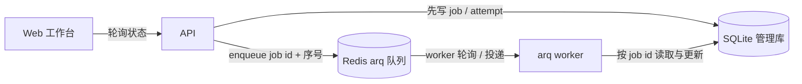

# 开发中的思考和经验：异步任务队列

这份笔记记录 CodeTrail 当前异步任务实现与讨论结论。当前行为以源码和锁定的 arq 安装版本为准；PR 2/3 内容明确标为计划。

## 组件各自负责什么？

API 把任务状态、attempt、进度、租约和结果先写进 SQLite，再把带有业务 `job_id` 与递增 dispatch 序号的消息投到 Redis。SQLite 是任务事实来源；Redis 只负责唤醒 worker 和传递 dispatch，不是状态缓存，也不反向回写任务状态。Worker 从 Redis 取出消息后，按 `job_id` 读取并更新 SQLite。Web 通过 API 轮询状态。

实现入口见 [jobs.py 的 JobStore.create / JobService.submit / _enqueue_unlocked](../../apps/api/app/jobs.py)、[worker.py](../../apps/api/app/worker.py) 和 [API 轮询路由](../../apps/api/app/main.py)。arq Worker 默认 `poll_delay_s=0.5` 秒，CodeTrail 没有覆盖这个值（锁定环境 `apps/api/.venv/lib/python3.13/site-packages/arq/worker.py` 的 `Worker.__init__` 和 poll loop）。

## arq 在 Redis 里保存什么？

CodeTrail 调用 `enqueue_job("run_job", job_id, _job_id=f"{job_id}:{seq}")`。默认 serializer 是 `pickle.dumps`；序列化对象是包含 `t`（job try）、`f`（函数名）、`a`（位置参数）、`k`（关键字参数）、`et`（enqueue 时间 Unix 毫秒）的字典。`enqueue_job` 对 `arq:job:<dispatch-id>` 执行 `WATCH`，并检查 job/result 两个 key 是否存在；随后用事务 `PSETEX` 写 job 数据、`ZADD` 写 `arq:queue`，分数是计划运行时间的 Unix 毫秒值。普通 dispatch 默认 job key 有效期为计划时间加 24 小时；延迟任务会相应延长。

Worker 开始执行时写 `arq:in-progress:<dispatch-id>`。正常完成时移除队列成员和 job key；普通 in-progress key 会清理。CodeTrail 的 Worker 设置 `keep_result=60` 秒，因此普通结果键是短期保留；cron job 自身使用 arq 的 `keep_result=0` 默认值，其 in-progress key 会保留 60 秒以挡住重复 tick。未执行的 job key 有 24 小时有效期，正常 worker 消费也会清理队列成员；Redis 不是 grow-only 的任务日志。不过队列 sorted-set 成员本身没有独立 TTL，异常后要由 worker 处理，不能把它说成所有数据都会自动到期。状态与结果摘要保存在 SQLite。以上键格式、序列化字段和过期行为来自锁定 arq 源码的 `connections.py`、`worker.py`、`cron.py` 与 `constants.py`。

## Worker 失联后如何恢复？

`JobService.run` 在 SQLite 成功 claim 后启动心跳线程，约每个租约的三分之一续写 `lease_expires_at`。租约属于应用服务，在 worker 进程内运行，不由 Docker 提供。租约过期后 `recover_expired` 把任务记为 `worker_lost`，在 `CODETRAIL_JOB_MAX_RETRIES` 预算内重排；默认上限为 2，耗尽后任务失败。重放是至少一次语义。

索引构建先生成候选快照，再通过项目更新提交路径发布 latest 和 ready 状态；中途终止的候选不会仅因 worker 失联变成 ready。进程崩溃后，已提交的 SQLite 状态保留在共享数据卷，租约到期后可以恢复；主机突然断电时，最终能恢复哪些写入仍取决于 SQLite、文件系统和 Redis 的持久化落盘行为。当前 Compose 明确传 `--appendonly yes` 并挂载 `redis-data`，显式启用 AOF，未显式覆盖 Redis 默认 RDB `save` 配置。AOF 与 SQLite 之间不是一个原子事务，扫描用 SQLite 状态补偿丢失或未投递的 dispatch。

恢复扫描还处理“SQLite 已写 queued、API 在 enqueue 前退出”或“Redis dispatch 已丢失”的情况。之前扫描用一次查询得到 queued 行，后续每轮都无条件重新投递，导致每次生成新序号：一个积压任务会产生 N 条 dispatch；轻量模式也会把同一 job 反复提交到线程池。当前实现检查 Redis 中当前序号的 job、in-progress 和队列成员；若都不存在，才补投一次。投递前在 dispatch 锁内重新读取 status、`merged_into`、`retry_after_at` 和 `enqueue_seq`，只处理仍 queued 或已到期 retry_wait 的行，避免用扫描开始时的旧序号覆盖期间发生的重试。锁只协调当前进程，不能关闭跨进程竞态。`enqueue_seq=0` 的新行有 2 秒首投递宽限，避免扫描抢在 API 完成 SQLite/Redis 两步之间；宽限后仍未投递的旧行会补投。无 Redis 的轻量模式用每 job 的 scheduled 集合防止重复提交 future。

## 为什么用 Redis 队列？

API 和 worker 是不同进程，未来也可以在不同机器上；进程内列表不能跨进程传递任务。直接用数据库轮询也可行，例如 PostgreSQL 的 `SELECT ... FOR UPDATE SKIP LOCKED`，但 SQLite 没有这个并发消费模型，且把队列调度和任务状态并入一个存储会增加当前 MVP 的存储复杂度。Kafka 面向持久事件流和高吞吐分区消费；RabbitMQ/Celery 能提供更广的 broker、路由和运维能力，但当前任务种类与规模还不需要这些组件。arq 提供基于 Redis 的轻量 asyncio worker；业务状态、审计、租约和恢复仍由应用负责。

诚实地说，PR 1 对 Redis 的使用很少：一个 dispatch 队列、在途标记和短期结果。PR 2 才计划增加带 fencing token 的分布式锁、共享 GitHub 限流和响应缓存；这些还没有实现，详见[后端基础设施决策](../decisions/2026-10-28-backend-infrastructure-evolution.md)。

队列去重不能代替分布式锁。相同仓库与解析后 commit 的构建任务在 PR 1 已通过 `job_build_keys` 合并，活动任务用 `merged_into` 关联，成功后也可复用 ready index；但两个不同 job 仍可能同时更新同一个项目。PR 2 计划使用 Redis `SET key value NX PX ttl` 获得有租期的锁，释放时先比较 owner value 再删除，并以 fencing token 拒绝过期持有者提交。arq 在 job 执行期间仍保留队列 sorted-set 成员，完成时才移除；它的 job id 去重只针对同一个 dispatch id，且受 job/result/in-progress key 的保留窗口限制，不能保护两个不同 job 的共享资源。

## SQLite 现在够用吗？

当前规模下每个任务只有少量状态写入和租约心跳，SQLite 足够；它是单写者存储，API 与 worker 必须访问同一个共享数据卷，不能把两个本地文件系统当成共享 SQLite。`jobs.py`、`ManagementStore` 和 `IndexStore` 的连接均设 `sqlite3.connect(timeout=5)`，没有显式 `PRAGMA busy_timeout`；`IndexStore` 显式启用 `foreign_keys`，但 jobs/管理库没有启用 WAL，也没有 `PRAGMA journal_mode=WAL`。多实例和更高写入并发到来时，PR 3 计划迁移 PostgreSQL。

## Worker 如何启动？

API 和 worker 共用 `apps/api` 代码及 `apps/api/Dockerfile` 构建出的镜像；Compose 的 worker command 是 `uv run --project apps/api codetrail worker`。CLI 要求配置 `CODETRAIL_REDIS_URL`，随后调用 arq `run_worker(worker_settings())`。启动回调 `create_services()` 构造和 API 同类的服务/JobService；`run_job` 通过 `asyncio.to_thread(JobService.run, ...)` 隔离同步任务。worker 设置 `max_jobs=CODETRAIL_WORKER_CONCURRENCY`（默认 2）、`job_timeout=CODETRAIL_JOB_TOTAL_TIMEOUT + 30`（总期限默认 1800 秒）以及 `keep_result=60`。不配置 Redis 时由 API 进程内线程池和恢复线程处理任务；API 停止期间没有独立 worker，重启后依赖 SQLite 恢复扫描重新调度 queued/过期租约任务。

## 多个 Worker 为什么都跑 cron？

`cron(recover_jobs, second={0,10,20,30,40,50})` 是按墙上时钟的秒字段对齐，不是从每个 worker 启动时刻开始计时。arq 从 worker 当前时间计算下一次匹配时间；唯一 ID 形如 `recover_jobs:<tick 的 Unix 毫秒>`，在 CodeTrail 中就是 `cron:recover_jobs:<tick ms>`。`unique=True` 是 cron 默认值。每个 worker 都会在 tick 窗口尝试 enqueue；`enqueue_job` 检查 job/result key，并 WATCH job key 后事务写入，因此并发尝试在 job key 存在期间只有一个能创建 dispatch。这个唯一性受 key 生命周期和时钟影响，不是永久去重：cron result 保留为 0，完成时 job key 会删除，之后相同 ID 理论上可再次入队；worker 会单独检查保留 60 秒的 in-progress 标记，避免这段时间内重复开始执行。这个标记过期后，迟到的同 ID enqueue 仍可能执行。

Worker 时钟偏差不能简单表述为“小于 10 秒就一定是同一 tick”。只要不同 worker 算出相同 `next_run`，它们就得到相同 ID；若偏差恰好让 worker 落在计划边界两侧，即使偏差不足 10 秒，也可能算出相邻 tick。恢复扫描本身幂等，偶尔重复运行只增加扫描成本，不会重复投递一个当前仍存在的 dispatch。

分布式 cron 避免单独维护调度器，但每个活跃 worker 都会进行轻量 Redis enqueue 尝试。专用 scheduler（类似 Celery beat）可以减少多 worker 的重复尝试，却需要自身的心跳、主备切换或 leader election，否则 scheduler 本身会成为单点。worker 数量很大、全量扫描成本显著，或业务要求精确的一次调度时，再考虑拆出专用 scheduler。

## 核对位置

- CodeTrail：[`jobs.py`](../../apps/api/app/jobs.py)、[`worker.py`](../../apps/api/app/worker.py)、[`cli.py`](../../apps/api/app/cli.py)、`docker-compose.yml`、[`Dockerfile`](../../apps/api/Dockerfile)、[`storage.py`](../../apps/api/app/storage.py)。
- 决策与分期：[`后端基础设施演进`](../decisions/2026-10-28-backend-infrastructure-evolution.md)。
- 安装版本源码：`apps/api/.venv/lib/python3.13/site-packages/arq/{connections.py,worker.py,cron.py,constants.py}`。
